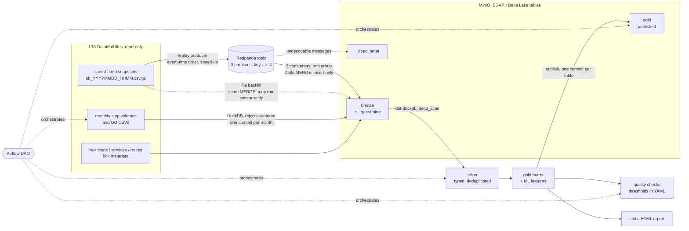

# sg-traffic-lakehouse

A lakehouse pipeline for Singapore land-transport data that runs on one machine. It covers streaming and batch
ingest into Delta Lake tables, a bronze/silver/gold (medallion) layout, dbt models and tests, data-quality checks,
an Airflow DAG and a reproducibility check.

The data comes from LTA DataMall:

- traffic speed bands for all 143,787 road links, sampled about every 20 minutes;
- monthly bus tap-in/tap-out volumes per stop;
- monthly origin-destination trips between stops;
- the bus network (stops, services, routes).

This is a personal project from 2026. Nothing runs in the cloud:

- **MinIO** stands in for Amazon S3.
- **Redpanda**, which speaks the Kafka API, stands in for a managed Kafka service.
- Both run in Docker on a laptop (WSL2, 8 cores, 7 GB RAM).

The streaming input is recorded snapshots **replayed** in event-time order, not a live feed.

## Architecture



| Layer | Where | What |
|---|---|---|
| bronze | `s3://sgtl-lake/bronze/<table>` (Delta) | Data as published, with types enforced. Speed bands: one table partitioned by `obs_date`, `obs_hour` (event time) and `part` (Kafka partition). Volumes: partitioned by `month`. Rejected rows go to `bronze/_quarantine/<table>`, undecodable stream messages to `bronze/_dead_letter/speedband_stream`. |
| silver | DuckDB warehouse (dbt) | Typed and renamed; band 0 and band 8's open upper bound (999) set to NULL; snapshot and link dimensions; a calendar derived from the data, with MOM public holidays. |
| gold | DuckDB, published to `s3://sgtl-lake/gold/<table>` (Delta) | `gold_link_speed_hourly`, `gold_congestion_episodes`, `gold_stop_demand_hourly`, `gold_top_od_flows`, `gold_link_hour_features`. |

Code map:

| Path | Purpose |
|---|---|
| `src/lakehouse/producer.py` | Replays snapshots to Kafka, in event-time order, with optional duplicates and late snapshots. |
| `src/lakehouse/consumer.py` | Reassembles snapshots per partition, drops repeats, tracks the watermark, handles rebalances, dead-letters bad messages and writes bronze. |
| `src/lakehouse/speedbands.py` | Snapshot parsing with row-level quarantine, the insert-only Delta MERGE, file backfill. |
| `src/lakehouse/batch_ingest.py` | Monthly CSVs and JSON to bronze: header check, rejected lines, integer and domain rules, quarantine, independent source counts. |
| `src/lakehouse/storage.py` | Delta table access (delta-rs) and DuckDB connections (`delta_scan`). |
| `src/lakehouse/profiling.py` | Profiles bronze and reconciles it with the source counts. |
| `dbt/` | Silver and gold models, generic and singular tests, seeds (holidays, band and road-category references). |
| `src/lakehouse/quality.py`, `config/quality_thresholds.yml` | Custom data-quality checks and their thresholds. |
| `src/lakehouse/publish.py`, `repro.py` | Gold export with file and content hashes; the reproducibility check. |
| `airflow/dags/sg_traffic_lakehouse.py` | The DAG. |
| `src/lakehouse/cli.py` | `python -m lakehouse <command>`; runs the same pipeline without Airflow. |
| `tests/` | pytest suite (with an in-memory Kafka double), synthetic fixture generator, mutation check. |

## How to run

All commands run in WSL/Linux from the repository root, with Python 3.12.

### On the synthetic fixture (no Docker, what CI runs)

```bash
python -m venv .venv && . .venv/bin/activate && pip install -r requirements.txt
make test               # pytest: unit tests + end-to-end fixture run (dbt build with all dbt tests) + reproducibility
make fixture-pipeline   # ingest -> profile -> dbt build -> quality -> publish -> report, local-directory lake
make mutate             # planted bugs in Python and SQL; every one must make a test fail
```

The fixture (`tests/fixtures`, written by `tests/make_fixture.py`) is synthetic. It contains planted defects:

- a sampling gap, a stale snapshot, an incomplete snapshot and an unknown link;
- band 0;
- a malformed line and a non-numeric band in a speed-band file, and a link repeated with a different band;
- bad rows for each quarantine rule, lines with too many and too few fields, a decimal volume;
- a stop missing from the stop list;
- tied OD flows;
- a January 2027 volume file (the calendar must extend itself; there is no 2027 holiday list).

The end-to-end tests check the gold tables against values worked out by hand. They also plant a duplicate key in
bronze with a raw append that bypasses the MERGE, and check that silver keeps the first copy.

### Full local stack on the real data

The real DataMall files are read from the `sg-bus-network-monitor` repository (`SOURCE_DIR` in `.env`) and are
not copied into this repository.

```bash
cp .env.example .env          # local MinIO credentials and paths
make up                       # Redpanda (localhost:29092) + MinIO (API localhost:29000, console :29001)
make stream                   # streaming measurements -> results/stream_benchmark.json
make pipeline                 # batch pipeline against MinIO, strict quality gate -> results/*.json
make repro                    # pipeline twice from empty buckets -> results/reproducibility.json
make airflow                  # Airflow standalone (localhost:28080), trigger the DAG -> results/airflow/dag_run.json
make docs summary             # docs/CATALOG.md, results/SUMMARY.md and the block below
make down
```

`UNTIL=YYYYmmddHHMM` (Singapore time) pins the set of speed-band snapshots, so every step sees the same input while
the sampler keeps adding files. The Airflow DAG takes the same cutoff from the run's `data_interval_end`;
`make airflow` triggers a run whose logical date is `UNTIL`. The optional live mode (`python -m lakehouse live`)
reads a DataMall key from `LTA_KEY` at run time. It was not run for this README.

## Measured results

<!-- results:start -->
_Generated by `python -m lakehouse summarize` from the files in `results/`; do not edit by hand._

### Inputs

- 25 speed-band snapshots from 2026-09-26 19:28:00 to 2026-09-27 19:23:00 (SGT), 143,787 links each, 3,594,675 rows in total; 0 rows quarantined; 0 repeated links within a file, 0 of them with a different band.
- Stop tap-in/tap-out files: 2026-02, 2026-06, 2026-07, 2026-08; 812,444 rows read, 14 quarantined.
- Origin-destination files: 2026-07, 2026-08; 12,053,007 rows read, 0 quarantined.

### Streaming (Redpanda -> consumers -> Delta table on MinIO)

25 snapshots, 3 consumer processes (one per partition), measured by `python -m lakehouse stream-bench`. Latency is from the producer's timestamp on a partition's end-of-snapshot marker to the end of the Delta commit that writes that slice to bronze (one value per snapshot and partition).

| Run | Messages produced | Producer msg/s | Consumer records/s | Latency p50 | p95 | max |
|---|---|---|---|---|---|---|
| throughput (unpaced, 1% duplicates, 2 late snapshots) | 3,631,086 | 41,805 | 26,373 | 5.0 s | 10.0 s | 11.7 s |
| latency (paced x120) | 3,594,750 | 67,151 | paced | 1.9 s | 4.5 s | 4.9 s |
| re-run to a new topic and group | 3,594,750 | 62,532 | 32,975 | - | - | - |

- The paced run is the meaningful latency: 75 slices. In the unpaced throughput run the producer outruns the consumers, so its latency is mostly queueing. The re-run row has no latency: every slice was already stored, so there was no commit to time.
- Messages include 75 end-of-snapshot markers (one per snapshot and partition); consumer rates count link records only.
- Duplicates: 36,336 injected, 36,336 dropped by the consumers, 0 of the repeated keys with a different payload. Bronze holds 3,594,675 rows, 0 duplicate keys.
- Late data: 2 snapshots held back and sent last were flagged late (2026-09-26 21:24:00, 2026-09-27 16:51:00), written to their own event-time partitions and stored with `_late = true`; 0 incomplete flushes.
- Re-run: the same data to a new topic and a new consumer group. 3,594,675 records consumed again, 0 new rows, 0 Delta commits; table version 75 before and 75 after. This shows that the sink is idempotent; it says nothing about crash recovery, which the next run tests.
- Crash and restart: each of the 3 consumers exited abruptly (exit codes 70, 70, 70) right after its 5th bronze write, before committing offsets; bronze then held 718,935 rows. Three new consumers joined the same group and resumed from the committed offsets (3,139,525 records consumed, 5 slices delivered again that were already stored, 2,875,740 rows written), while the file backfill wrote the same snapshots into the same table (0 rows written). Conflicting commits were retried 0 times: no two writers committed to the same slice at once in this run, so the race itself is covered only by tests/test_speedbands.py, which forces it. Final bronze: 3,594,675 rows, 0 duplicate keys.

### Rows per layer

Bronze and gold are Delta tables; file counts are data files in the current version.

| Layer | Table | Rows |
|---|---|---|
| bronze | speedbands (75 files) | 3,594,675 |
| bronze | speedband_links (1 file) | 143,787 |
| bronze | pv_stop (4 files) | 812,430 |
| bronze | pv_od (2 files) | 12,053,007 |
| bronze | bus_stops (1 file) | 5,209 |
| bronze | bus_services (1 file) | 802 |
| bronze | bus_routes (1 file) | 26,842 |
| bronze | _quarantine (4 files) | 14 |
| bronze | _dead_letter (0 files) | 0 |
| silver | stg_speedband_obs | 3,594,675 |
| silver | dim_snapshot | 25 |
| silver | dim_link | 143,787 |
| silver | dim_calendar | 365 |
| silver | dim_month_day_counts | 24 |
| silver | dim_bus_stop | 5,209 |
| silver | dim_bus_service | 802 |
| silver | fct_bus_route_stop | 26,842 |
| silver | stg_stop_pv | 812,430 |
| silver | stg_od | 12,053,007 |
| gold | gold_link_speed_hourly | 1,293,678 |
| gold | gold_congestion_episodes | 11,015 |
| gold | gold_stop_demand_hourly | 812,430 |
| gold | gold_top_od_flows | 200 |
| gold | gold_link_hour_features | 1,437,420 |

### Load validation

- Source-to-bronze reconciliation of the monthly files and the link file: 7/7 match. Source rows and volume sums come from a separate Python pass over each raw file; the check is bronze rows + quarantined rows = source rows, and the same for every volume column. Each file's SHA-256 is stored in the metadata of the Delta commit that loaded it.
- Speed-band snapshots: 25/25 files reconcile (source rows = distinct links in bronze + quarantined rows + repeated links in the file).
- Duplicate keys in bronze: speedbands 0, speedband_links 0, pv_stop 0, pv_od 0, bus_stops 0, bus_services 0, bus_routes 0.

### Data-quality findings

| Check | Status | Value | Threshold |
|---|---|---|---|
| snapshot_completeness | PASS | 1.0 | 0.99 |
| stale_snapshot | PASS | 0.1869 | 0.05 |
| cadence_gap | WARN | 2 | min_minutes 10, max_minutes 30 |
| unknown_link_ids | PASS | 0 | 0 |
| unobserved_metadata_links | PASS | 0 | None |
| unknown_band_share | PASS | 0.000313 | 0.001 |
| sampler_log_consistency | INFO | 46 | 47 |
| od_vs_tapin | PASS | 0.000186 | 0.001 |
| pv_stops_missing_from_master | PASS | 0.0002 | 0.01 |
| quarantine_share | PASS | 8.4e-07 | 0.0001 |

- Sampling cadence: 22 of 24 intervals were regular (17.0-21.0 min, median 19.0 min).
- Gap of 1,009 min from 2026-09-26 23:01:00 to 2026-09-27 15:50:00: no snapshots.
- Only 5 min between 2026-09-26 19:28:00 and 2026-09-26 19:33:00.
- sampler.log had 46 fetch lines for 47 snapshot files in the folder when the check ran (25 of them up to the cutoff; the sampler was still running). Every line reports 143,787 rows. The log has no timestamps, so it cannot be cut at the cutoff or matched to files; the check is information only.
- Stale snapshots: 0; between consecutive snapshots 18.7%-48.2% of links changed band.
- Band outside 1-8 (published as 0 with no speed range): 1,125 rows on 45 links; set to NULL in silver.
- OD trips vs stop tap-ins: 2026-07 weekday 0.0135%; 2026-07 weekends/holiday 0.0186%; 2026-08 weekday 0.0142%; 2026-08 weekends/holiday 0.0174%.
- 6 stops in the passenger volumes are not in the 2026-09-26 stop list; they carry 92,368 tap-ins (0.0200%).
- Quarantined at ingest: 14 of 16,636,766 rows (pv_stop: missing_or_uncastable_time_per_hour 14); together they hold 0 TOTAL_TAP_IN_VOLUME, 22 TOTAL_TAP_OUT_VOLUME, 0 TOTAL_TRIPS.

### Reproducibility

The batch pipeline ran twice from empty buckets (snapshots up to 202609271923), 238.3 s and 285.1 s.

| Gold table | Rows | Same Parquet bytes | Same content |
|---|---|---|---|
| gold_link_speed_hourly | 1,293,678 | yes | yes |
| gold_congestion_episodes | 11,015 | yes | yes |
| gold_stop_demand_hourly | 812,430 | yes | yes |
| gold_top_od_flows | 200 | yes | yes |
| gold_link_hour_features | 1,437,420 | yes | yes |

The two runs built bronze speed bands from the snapshot files. In the main pipeline run the file backfill added 0 rows to the bronze written by the Kafka consumers, and its gold has the same content hashes as the two runs: yes.

### Batch pipeline runs

- Without Airflow (`python -m lakehouse pipeline`): ingest-batch 586.6 s, ingest-speedbands 65.28 s, profile 27.64 s, dbt-build 85.77 s, quality 2.6 s, publish 26.25 s, report 16.29 s; total 810 s.
- Airflow DAG `sg_traffic_lakehouse` run `manual__20260928T040548`, triggered with logical date 2026-09-27T11:23:00+00:00 for the cutoff 202609271923 (the ingest task logged "snapshot cutoff: 202609271923 SGT (from 2026-09-27T11:23:00+00:00)"): **success** in 393.8 s. Tasks: ingest_batch success (261.2 s); ingest_speedbands success (37.5 s); profile_bronze success (24.0 s); dbt_build success (36.0 s); quality_checks success (3.4 s); publish_metrics success (25.8 s).
- Durations were measured while other workloads shared the machine, so they vary a lot between runs.

### Tests

- 102 pytest tests pass on the unmodified code: unit tests (including the consumer against an in-memory broker, killed right after its n-th bronze write for several n), the end-to-end fixture run (whose dbt build runs 90 dbt tests) and the fixture reproducibility check.
- Mutation check: 65/65 planted bugs killed (51 in Python, 14 in dbt SQL; 10 of them are the mutants an external review added).
<!-- results:end -->

The static report with charts from the gold layer is `results/report.html`. The data-quality details are in
`results/quality_report.md`, and the bronze profile is in `results/profile_bronze.md`.

## Design decisions

- **Delta Lake tables on MinIO, written with delta-rs and read with DuckDB's `delta` extension.**
  - An earlier version of this repository wrote plain Parquet objects and called each write atomic. That was
    true of a single PUT, not of the read-merge-write around it. An external review reproduced two failures:
    - the file backfill and a consumer wrote the same object, and bronze kept 1 of 4 rows;
    - a reload deleted a month and then failed, which left the month empty.
  - Now every write is one Delta commit. A commit is the next `_delta_log/<version>.json`, written with a
    put-if-absent (a conditional PUT with `If-None-Match` on MinIO; the stack smoke test checks that an existing
    commit file is never overwritten). Readers see whole commits only.
  - Speed bands are written with an insert-only MERGE (below). A monthly reload is one overwrite with a predicate
    on its month (`replaceWhere`). A load that fails half-way commits nothing: the month keeps its old rows, and
    a test makes the writer fail after its first batch to check this.
  - Gold is published the same way, one overwrite commit per table.
  - Why Delta rather than Iceberg: delta-rs needs nothing but the object store, because the transaction log sits
    next to the data. pyiceberg commits through a catalog, which would have been one more service to run.
    DuckDB reads both formats.
  - What this does not give: there is no catalog service (tables are addressed by path); files are neither
    compacted nor vacuumed (each MERGE adds one small file); and the data table and its quarantine table are two
    commits, not one transaction. The reconciliation below detects a load that stopped between the two.
- **Idempotent, insert-only writes.**
  1. The producer uses Kafka's idempotent producer, so broker-side retries are not duplicated.
  2. The consumer drops repeated keys within a (snapshot, partition) slice.
  3. The bronze MERGE inserts only `(snapshot_ts, link_id)` keys the table does not hold, and never updates a
     stored row: the first writer wins. A repeated key whose payload differs is counted and reported (see the
     results), not dropped silently.
- **At-least-once delivery, tested with crashes.**
  - Offsets are committed only when nothing is buffered: no pending slice and no unwritten dead letter.
  - A consumer that dies after a write but before the commit gets those records again, and the MERGE inserts
    nothing for them.
  - `tests/test_consumer.py` runs the consumer against an in-memory broker, kills it right after its n-th bronze
    write for several n, restarts it from the committed offsets and compares bronze with the source files.
  - `make stream` does the same on Redpanda with real process exits (the crash run in the results).
- **Partitions and concurrency.**
  - Records are keyed by link and sent to partition `link_id % 3`, and `part` is a partition column of the bronze
    table.
  - Consumers in one group own disjoint partitions, so their commits never conflict.
  - The file backfill writes the same slices and may run at the same time. If another writer committed into the
    slice after the MERGE read it, delta-rs rejects the commit and the upsert starts again from the new version.
    A test forces exactly this interleaving in both orders.
  - On a rebalance, `on_revoke` drops the buffers of revoked partitions. Their offsets were not committed past
    those records, so the new owner reads them again. Flushing them would write an incomplete slice.
- **Bad messages go to a dead-letter table.** A message that is not valid JSON, lacks a field, has a value of the
  wrong type or range, or sits on the wrong partition for its key is written to
  `bronze/_dead_letter/speedband_stream` with its offset and a reason. Before, it crashed the consumer on every
  restart.
- **Late and out-of-order data.**
  - Partitioning uses event time: the snapshot's own timestamp, not arrival time. A dbt singular test checks this.
  - Each consumer keeps a watermark: the slowest owned partition's newest event time minus 30 minutes.
  - A snapshot behind the watermark is written to its own event-time partition and stored with `_late = true`.
    Silver exposes it as `arrived_late`, next to `ingested_at_utc`.
  - Every silver and gold model is a table that `dbt build` rebuilds in full from bronze. That is why a late
    snapshot needs no special handling: the next build includes it.
  - The cost of a full rebuild grows with history. At this size the build takes seconds, and a full rebuild is
    simpler to keep byte-reproducible. Incremental models would need a lookback window at least as long as the
    allowed lateness, plus a rule for rows that arrive later still (for example, rebuilding the partitions that
    received `_late` rows). They are not implemented.
- **Schema enforcement at ingest.**
  - The header must match exactly. A renamed, added or missing column stops the load: that is a change of
    contract, not a bad row.
  - A line with too many or too few fields does not stop the load. DuckDB's `store_rejects` captures it for the
    monthly CSVs and the link file, and pyarrow's invalid-row handler does the same for speed-band files. The line
    is quarantined as `malformed_row` with its raw text.
  - Values are read as text. Integer columns must look like integers: DuckDB's `TRY_CAST('5.5' AS BIGINT)`
    returns 6, so casting alone would have rounded a bad volume silently.
  - Bus stop codes stay text, because `01012` is not `1012`.
  - Rows that fail a rule are quarantined with the name of the first rule they fail.
  - The bus-network JSON pulls are the exception. Their key set must match, but a value of the wrong type stops
    the load; they are small API pulls that are refetched rather than repaired.
- **Reconciliation against an independent count.**
  - At load time a separate Python pass (the `csv` module, not DuckDB) counts each raw file's rows, sums its
    volume columns and hashes it.
  - `profile` then checks the lake as it is now: bronze rows + quarantined rows = source rows, and the same for
    each volume sum. Speed-band snapshots are checked in the same way.
  - The file's SHA-256 is also stored in the metadata of the Delta commit that loaded it.
- **The calendar comes from the data.**
  - `dim_calendar` spans whole years from the earliest to the latest date in the speed bands, stop volumes and
    OD trips.
  - A singular test fails the build if gold loses silver rows through an inner join, for example a month
    missing from the day counts.
  - The holiday seed has only 2026, so a year without holidays produces a dbt warning. The fixture's 2027 file
    triggers it on purpose.
- **Reproducible gold.**
  - Averages and standard deviations are computed from integer sums. A parallel floating-point sum could differ
    in the last bit between runs.
  - Gold is exported in key order with one DuckDB thread; delta-rs writes the same Parquet bytes for the same
    input.
  - The publish step records a hash over the table's data files and a content hash.
- **Quality thresholds are calibrated and explained** in `config/quality_thresholds.yml`.
  - The stale-snapshot threshold (5% of links changed) sits between an exact repeat (0%) and the smallest change
    observed between real snapshots.
  - The cadence gap (30 minutes) is the same number dbt uses to split sampling runs; a test keeps them equal.
  - The sampler-log check cannot be tied to the snapshot cutoff (the log has no timestamps), so it is information
    only.
- **The pipeline also runs without Airflow.** Every DAG task is one CLI command (`python -m lakehouse ...`). CI
  runs the same commands on the fixture. The DAG adds scheduling, a cutoff taken from `data_interval_end`,
  retries for the idempotent steps, and a strict quality gate with no retries.
- **MinIO image.** `minio/minio` (Docker Hub) and `quay.io/minio/minio` could not be pulled on 2026-09-27. The
  stack uses Chainguard's build of the MinIO server, pinned by digest. GitHub Actions are pinned to commit SHAs.

## Limits

- **Local only.** MinIO and Redpanda in Docker on one laptop, not a cloud deployment. There is no IAM, no network
  isolation and no high availability. Throughput and latency depend on this machine, which was shared with other
  workloads during the runs. Each of the three consumers is a single-threaded Python process parsing JSON, and
  each bronze write is a Delta MERGE, which costs more than the plain object PUT it replaced.
- **Delta without the platform around it.** Tables have no catalog, and nothing compacts small files or vacuums
  old ones. The data table and its quarantine table are committed separately.
- **The independent source count costs time.** It is a single-threaded Python pass over each raw file: about 35-40 s
  for one 6-million-row OD file on this machine when measured alone, and much more while other workloads ran (the
  `ingest-batch` time in the results).
- **Airflow attempts terminated by the scheduler.** The Airflow run reported for the previous version of this
  repository had two task attempts terminated by the scheduler and retried. Their logs were not kept, so the cause
  is not known. `scripts/airflow_run.sh` now saves the relevant log lines to
  `results/airflow/terminated_attempts.log` when it happens; in the run reported above, no attempt was terminated.
- **Replayed, not live.** The stream is recorded snapshots replayed faster than real time. Pacing compresses about
  18 minutes of event time into 9 seconds. The real feed needs only about 130 records per second: 143,787 links
  every 15-20 minutes.
- **Small sample.**
  - The speed bands cover one Saturday evening and one Sunday afternoon/evening. That is enough to exercise the
    pipeline, but not to describe typical traffic.
  - No weekday peak had been sampled when these results were produced.
  - Hour-of-day profiles rest on one or two days per cell.
- **Congestion episodes.**
  - An episode is defined by speed band only (band ≤ 2 for at least 3 consecutive snapshots on road categories
    1-3).
  - An episode needs three consecutive snapshots, so it spans at least two sampling intervals. Queues that clear
    between two samples are missed.
  - Band 2 or below on an arterial road is often the link's normal state (for example, a short link between
    signals), not an incident. In `results/report.html` the longest episodes on every road category have 13
    snapshots: every snapshot of the Saturday sampling run. With more days, a relative rule would separate real congestion better:
    for example, a band below the link's usual band for that hour.
- **ML features.** The feature table is built but no model is trained. With two partial days of snapshots it is
  a working scaffold, not a training set: the `next_hour_mean_band` label is NULL for the last sampled hour of each
  run, and there are no weekday rows.
- **Governance is documentation.** Classification and ownership are dbt `meta` tags and
  [docs/GOVERNANCE.md](docs/GOVERNANCE.md). No catalog enforces access.

## Data licence

Contains information from LTA DataMall (Traffic Speed Bands, Passenger Volume by Bus Stops, Passenger Volume by
Origin Destination Bus Stops, Bus Stops, Bus Services, Bus Routes), accessed 26-27 September 2026. The data is made
available under the terms of the [Singapore Open Data Licence version 1.0](https://data.gov.sg/open-data-licence).
Provenance and terms: [docs/GOVERNANCE.md](docs/GOVERNANCE.md). Catalogue and lineage:
[docs/CATALOG.md](docs/CATALOG.md).
