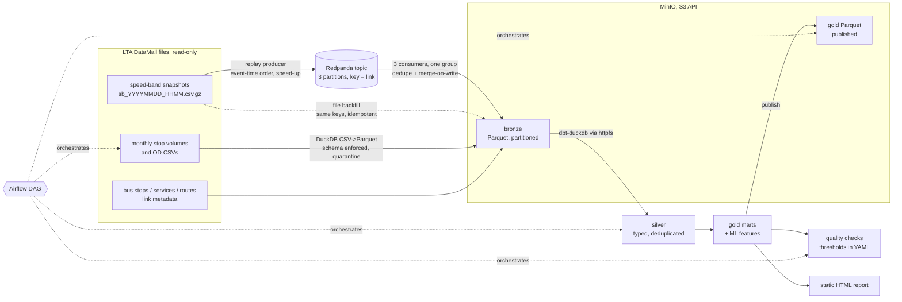

# sg-traffic-lakehouse

A lakehouse pipeline for Singapore land-transport data that runs on one machine. It covers streaming and batch
ingest, a bronze/silver/gold (medallion) layout, dbt models and tests, data-quality checks, an Airflow DAG and a
reproducibility check.

The data comes from LTA DataMall:

- traffic speed bands for all 143,787 road links, sampled about every 20 minutes;
- monthly bus tap-in/tap-out volumes per stop;
- monthly origin-destination trips between stops;
- the bus network (stops, services, routes).

This is a personal project from 2026. Nothing runs in the cloud:

- **MinIO** stands in for Amazon S3.
- **Redpanda**, which speaks the Kafka API, stands in for a managed Kafka service.
- Both run in Docker on a laptop (WSL2, 8 cores, 7 GB RAM).

The streaming input is recorded snapshots **replayed** in event-time order, not a live feed.

## Architecture



| Layer | Where | What |
|---|---|---|
| bronze | `s3://sgtl-lake/bronze/...` | Data as published, with types enforced. Speed bands: `obs_date=/obs_hour=/snapshot=<ts>-p<partition>.parquet`. Volumes: `month=YYYY-MM/`. Rejected rows go to `bronze/_quarantine/`. |
| silver | DuckDB warehouse (dbt) | Typed and renamed; band 0 and band 8's open upper bound (999) set to NULL; snapshot and link dimensions; calendar with MOM 2026 public holidays. |
| gold | DuckDB, exported to `s3://sgtl-lake/gold/` | `gold_link_speed_hourly`, `gold_congestion_episodes`, `gold_stop_demand_hourly`, `gold_top_od_flows`, `gold_link_hour_features`. |

Code map:

| Path | Purpose |
|---|---|
| `src/lakehouse/producer.py` | Replays snapshots to Kafka, in event-time order, with optional duplicates and late snapshots. |
| `src/lakehouse/consumer.py` | Reassembles snapshots per partition, drops duplicates, tracks the watermark and writes bronze. |
| `src/lakehouse/speedbands.py` | Snapshot parsing, bronze object keys, merge-on-write upsert, file backfill. |
| `src/lakehouse/batch_ingest.py` | Monthly CSVs and JSON to bronze: header check, `TRY_CAST`, domain rules, quarantine. |
| `src/lakehouse/profiling.py` | Profiles bronze and reconciles it with the source files. |
| `dbt/` | Silver and gold models, generic and singular tests, seeds (holidays, band and road-category references). |
| `src/lakehouse/quality.py`, `config/quality_thresholds.yml` | Custom data-quality checks and their thresholds. |
| `src/lakehouse/publish.py`, `repro.py` | Gold export with file and content hashes; the reproducibility check. |
| `airflow/dags/sg_traffic_lakehouse.py` | The DAG. |
| `src/lakehouse/cli.py` | `python -m lakehouse <command>`; runs the same pipeline without Airflow. |
| `tests/` | pytest suite, synthetic fixture generator, mutation check. |

## How to run

All commands run in WSL/Linux from the repository root, with Python 3.12.

### On the synthetic fixture (no Docker, what CI runs)

```bash
python -m venv .venv && . .venv/bin/activate && pip install -r requirements.txt
make test               # pytest: unit tests + end-to-end fixture run (dbt build with all dbt tests) + reproducibility
make fixture-pipeline   # ingest -> profile -> dbt build -> quality -> publish -> report, local-directory lake
make mutate             # planted bugs in Python and SQL; every one must make a test fail
```

The fixture (`tests/fixtures`, written by `tests/make_fixture.py`) is synthetic. It contains planted defects:

- a sampling gap, a stale snapshot, an incomplete snapshot and an unknown link;
- band 0;
- bad rows for each quarantine rule;
- a stop missing from the stop list;
- tied OD flows.

The end-to-end tests check the gold tables against values worked out by hand.

### Full local stack on the real data

The real DataMall files are read from the `sg-bus-network-monitor` repository (`SOURCE_DIR` in `.env`) and are
not copied into this repository.

```bash
cp .env.example .env          # local MinIO credentials and paths
make up                       # Redpanda (localhost:29092) + MinIO (API localhost:29000, console :29001)
make stream                   # streaming measurements -> results/stream_benchmark.json
make pipeline                 # batch pipeline against MinIO, strict quality gate -> results/*.json
make repro                    # pipeline twice from empty buckets -> results/reproducibility.json
make airflow                  # Airflow standalone (localhost:28080), trigger the DAG -> results/airflow/dag_run.json
make docs summary             # docs/CATALOG.md, results/SUMMARY.md and the block below
make down
```

`UNTIL=YYYYmmddHHMM` pins the set of speed-band snapshots, so every step sees the same input while the sampler
keeps adding files. The optional live mode (`python -m lakehouse live`) reads a DataMall key from `LTA_KEY` at run
time. It was not run for this README.

## Measured results

<!-- results:start -->
_Generated by `python -m lakehouse summarize` from the files in `results/`; do not edit by hand._

### Inputs

- 25 speed-band snapshots from 2026-09-26 19:28:00 to 2026-09-27 19:23:00 (SGT), 143,787 links each, 3,594,675 rows in total.
- Stop tap-in/tap-out files: 2026-02, 2026-06, 2026-07, 2026-08; 812,444 rows read, 14 quarantined.
- Origin-destination files: 2026-07, 2026-08; 12,053,007 rows read, 0 quarantined.

### Streaming (Redpanda -> consumers -> MinIO bronze)

25 snapshots, 3 consumer processes (one per partition), measured by `python -m lakehouse stream-bench`.

| Run | Messages produced | Producer msg/s | Consumer records/s | Latency p50 | p95 | max |
|---|---|---|---|---|---|---|
| throughput (unpaced, 1% duplicates, 2 late snapshots) | 3,631,086 | 72,895 | 55,409 | 2.3 s | 3.3 s | 4.3 s |
| latency (paced x120) | 3,594,750 | 115,294 | paced | 1.5 s | 2.7 s | 4.2 s |
| re-run of the same data | 3,594,750 | 160,357 | 136,884 | 1.1 s | 2.0 s | 2.6 s |

- Latency is from the producer's timestamp on a record to the moment its bronze object was written to MinIO. In the unpaced runs the producer outruns the consumers, so latency there is mostly queueing; the paced run is the meaningful one. There the producer takes 1.2 s to send one snapshot, and a bronze object is written only when its partition's end-of-snapshot marker arrives, so most of the latency is waiting for the rest of the snapshot.
- Messages include 75 end-of-snapshot markers (one per snapshot and partition); consumer rates count link records only.
- Duplicates: 36,336 injected, 36,336 dropped by the consumers; bronze holds 3,594,675 rows = 25 snapshots x links, no duplicate key.
- Late data: 2 snapshots held back and sent last were flagged late (2026-09-26 21:24:00, 2026-09-27 16:51:00) and written to their own event-time partitions; 0 incomplete flushes.
- Re-run: 3,594,675 records consumed again, 0 new rows, 0 objects rewritten; all 75 bronze objects kept the same SHA-256: yes.

### Rows per layer

| Layer | Table | Rows |
|---|---|---|
| bronze | speedbands (75 files) | 3,594,675 |
| bronze | speedband_links (1 file) | 143,787 |
| bronze | pv_stop (4 files) | 812,430 |
| bronze | pv_od (2 files) | 12,053,007 |
| bronze | bus_stops (1 file) | 5,209 |
| bronze | bus_services (1 file) | 802 |
| bronze | bus_routes (1 file) | 26,842 |
| bronze | _quarantine (4 files) | 14 |
| silver | stg_speedband_obs | 3,594,675 |
| silver | dim_snapshot | 25 |
| silver | dim_link | 143,787 |
| silver | dim_calendar | 365 |
| silver | dim_month_day_counts | 24 |
| silver | dim_bus_stop | 5,209 |
| silver | dim_bus_service | 802 |
| silver | fct_bus_route_stop | 26,842 |
| silver | stg_stop_pv | 812,430 |
| silver | stg_od | 12,053,007 |
| gold | gold_link_speed_hourly | 1,293,678 |
| gold | gold_congestion_episodes | 11,015 |
| gold | gold_stop_demand_hourly | 812,430 |
| gold | gold_top_od_flows | 200 |
| gold | gold_link_hour_features | 1,437,420 |

### Load validation

- Source-to-bronze reconciliation (row counts and volume sums): 6/6 files match.
- Duplicate keys in bronze: speedbands 0, speedband_links 0, pv_stop 0, pv_od 0, bus_stops 0, bus_services 0, bus_routes 0.

### Data-quality findings

| Check | Status | Value | Threshold |
|---|---|---|---|
| snapshot_completeness | PASS | 1.0 | 0.99 |
| stale_snapshot | PASS | 0.1869 | 0.005 |
| cadence_gap | WARN | 2 | min_minutes 10, max_minutes 30 |
| unknown_link_ids | PASS | 0 | 0 |
| unobserved_metadata_links | PASS | 0 | None |
| unknown_band_share | PASS | 0.000313 | 0.001 |
| sampler_log_consistency | WARN | 35 | 36 |
| od_vs_tapin | PASS | 0.000186 | 0.001 |
| pv_stops_missing_from_master | PASS | 0.0002 | 0.01 |
| quarantine_share | PASS | 1.07e-06 | 0.0001 |

- Sampling cadence: 22 of 24 intervals were regular (17.0-21.0 min, median 19.0 min).
- Gap of 1,009 min from 2026-09-26 23:01:00 to 2026-09-27 15:50:00: no snapshots.
- Only 5 min between 2026-09-26 19:28:00 and 2026-09-26 19:33:00.
- sampler.log had 35 fetch lines for 36 snapshot files when the check ran (all files in the folder, not only those up to the cutoff; the sampler was still running). Every line reports 143,787 rows. The log has no timestamps, so the mismatch cannot be traced to particular files.
- Stale snapshots: 0; between consecutive snapshots 18.7%-48.2% of links changed band.
- Band outside 1-8 (published as 0 with no speed range): 1,125 rows on 45 links; set to NULL in silver.
- OD trips vs stop tap-ins: 2026-07 weekday 0.0135%; 2026-07 weekends/holiday 0.0186%; 2026-08 weekday 0.0142%; 2026-08 weekends/holiday 0.0174%.
- 6 stops in the passenger volumes are not in the 2026-09-26 stop list; they carry 92,368 tap-ins (0.0200%).
- Quarantined at ingest: 14 of 13,042,091 rows (missing_or_uncastable_time_per_hour 14); together they hold 0 TOTAL_TAP_IN_VOLUME, 22 TOTAL_TAP_OUT_VOLUME, 0 TOTAL_TRIPS.

### Reproducibility

The batch pipeline ran twice from empty buckets (snapshots up to 202609271923), 93.6 s and 108.7 s.

| Gold table | Rows | Same Parquet bytes | Same content |
|---|---|---|---|
| gold_link_speed_hourly | 1,293,678 | yes | yes |
| gold_congestion_episodes | 11,015 | yes | yes |
| gold_stop_demand_hourly | 812,430 | yes | yes |
| gold_top_od_flows | 200 | yes | yes |
| gold_link_hour_features | 1,437,420 | yes | yes |

The two runs built bronze speed bands from the snapshot files. In the main pipeline run the file backfill added 0 rows to the bronze written by the Kafka consumers, and its gold has the same content hashes as the two runs: yes.

### Batch pipeline runs

- Without Airflow (`python -m lakehouse pipeline`): ingest-batch 17.59 s, ingest-speedbands 5.97 s, profile 7.53 s, dbt-build 20.43 s, quality 0.69 s, publish 7.21 s, report 0.82 s; total 60 s.
- Airflow DAG `sg_traffic_lakehouse` run `manual__20260927T221227` (snapshots up to 202609271923): **success** in 3384.3 s. Tasks: ingest_batch success (520.7 s, attempt 2; 1 earlier attempt terminated by the scheduler); ingest_speedbands success (169.8 s); profile_bronze success (53.6 s); dbt_build success (591.3 s, attempt 2; 1 earlier attempt terminated by the scheduler); quality_checks success (364.0 s); publish_metrics success (99.6 s).
- Durations were measured while other workloads shared the machine, so they vary a lot between runs.

### Tests

- 48 pytest tests pass on the unmodified code: unit tests, the end-to-end fixture run (whose dbt build runs 87 dbt tests) and the fixture reproducibility check.
- Mutation check: 35/35 planted bugs killed (24 in Python, 11 in dbt SQL).
<!-- results:end -->

The static report with charts from the gold layer is `results/report.html`. The data-quality details are in
`results/quality_report.md`, and the bronze profile is in `results/profile_bronze.md`.

## Design decisions

- **Plain Parquet on S3, with a deterministic object key per write unit, instead of Iceberg or Delta.**
  - A speed-band snapshot is small: 143,787 rows, stored as three Parquet objects of well under 1 MB in total.
  - Each (snapshot, Kafka partition) pair is written as exactly one object, so each write is atomic: an S3 PUT
    either lands whole or not at all.
  - DuckDB reads the layout directly over httpfs, with no catalog service.
  - A table format would add snapshot isolation across many files, schema evolution and time travel. This workload
    does not need them yet.
  - The costs of this choice: no multi-object transactions, and listing a prefix replaces reading table metadata.
- **Idempotency in three layers.**
  1. The producer uses Kafka's idempotent producer, so broker-side retries are not duplicated.
  2. The consumer drops repeated `(snapshot_ts, link_id)` keys inside a batch.
  3. The bronze upsert is merge-on-write: it reads the existing object, keeps the first stored copy of each key and
     writes only if something is new.

  Offsets are committed only when nothing is buffered. Delivery is therefore at-least-once, and the sink absorbs
  the repeats. The re-run in the results above shows this: it replayed the whole topic and left every bronze
  object byte-identical.
- **One object per Kafka partition.** Records are keyed by link and sent to partition `link_id % 3`. Each bronze
  object has a single writer: the consumer that owns that partition. Consumers can therefore scale out without
  locking. The file backfill splits snapshots the same way, so the stream and the backfill produce the same keys.
- **Late and out-of-order data.**
  - Partitioning uses event time: the snapshot's own timestamp, not arrival time. A dbt singular test checks
    this.
  - Each consumer keeps a watermark: the slowest owned partition's newest event time minus 30 minutes.
  - A snapshot behind the watermark is flagged late but still written, and the next dbt build includes it.
- **Schema enforcement at ingest.**
  - The header must match exactly.
  - Values are read as text and cast with `TRY_CAST`.
  - Bus stop codes stay text, because `01012` is not `1012`.
  - Rows that fail a rule are quarantined with the name of the rule. They never silently disappear.
  - Each load reconciles row counts and volume sums with the source.
- **Reproducible gold.**
  - Averages and standard deviations are computed from integer sums. A parallel floating-point sum could differ
    in the last bit between runs.
  - Gold is exported in key order with one writer thread.
  - The publish step records both the Parquet file hash and a content hash.
- **The pipeline also runs without Airflow.** Every DAG task is one CLI command (`python -m lakehouse ...`). CI
  runs the same commands on the fixture, and the DAG adds scheduling, retries and a strict quality gate.
- **MinIO image.** `minio/minio` (Docker Hub) and `quay.io/minio/minio` could not be pulled on 2026-09-27. The
  stack uses Chainguard's build of the MinIO server, pinned by digest.

## Limits

- **Local only.** MinIO and Redpanda in Docker on one laptop, not a cloud deployment. There is no IAM, no network
  isolation and no high availability. Throughput and latency depend on this machine, which was shared with other
  workloads during the runs. Each of the three consumers is a single-threaded Python process parsing JSON.
- **Replayed, not live.** The stream is recorded snapshots replayed faster than real time. Pacing compresses about
  18 minutes of event time into 9 seconds. The real feed needs only about 130 records per second: 143,787 links
  every 15-20 minutes.
- **Small sample.**
  - The speed bands cover one Saturday evening and one Sunday afternoon/evening. That is enough to exercise the
    pipeline, but not to describe typical traffic.
  - No weekday peak had been sampled when these results were produced.
  - Hour-of-day profiles rest on one or two days per cell.
- **Congestion episodes.**
  - An episode is defined by speed band only (band ≤ 2 for at least 3 consecutive snapshots on road categories
    1-3).
  - An episode needs three consecutive snapshots, so it spans at least two sampling intervals. Queues that clear
    between two samples are missed.
  - Band 2 or below on an arterial road is often the link's normal state (for example, a short link between
    signals), not an incident. In `results/report.html` the longest episodes on every road category have 13
    snapshots: every snapshot of the Saturday sampling run. With more days, a relative rule would separate real
    congestion better: for example, a band below the link's usual band for that hour.
- **ML features.** The feature table is built but no model is trained. With two partial days of snapshots it is
  a working scaffold, not a training set: the `next_hour_mean_band` label is NULL for the last sampled hour of each
  run, and there are no weekday rows.
- **Governance is documentation.** Classification and ownership are dbt `meta` tags and
  [docs/GOVERNANCE.md](docs/GOVERNANCE.md). No catalog enforces access.

## Data licence

Contains information from LTA DataMall (Traffic Speed Bands, Passenger Volume by Bus Stops, Passenger Volume by
Origin Destination Bus Stops, Bus Stops, Bus Services, Bus Routes), accessed 26-27 September 2026. The data is made
available under the terms of the Singapore Open Data Licence version 1.0. Provenance and terms:
[docs/GOVERNANCE.md](docs/GOVERNANCE.md). Catalogue and lineage: [docs/CATALOG.md](docs/CATALOG.md).
