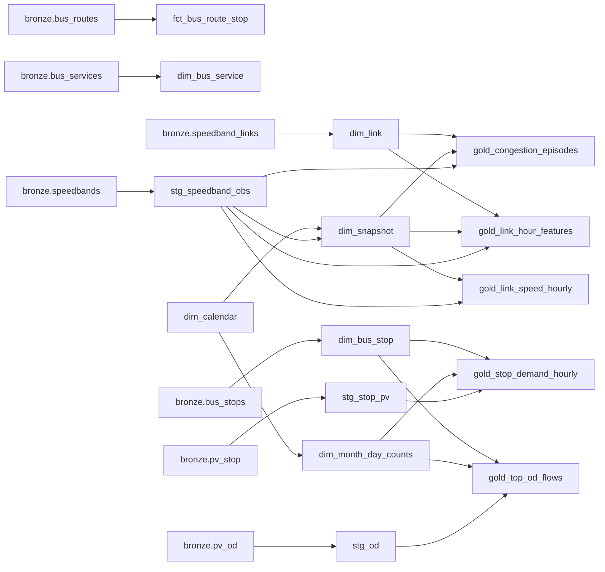

# Data catalogue

Generated by `tools/catalog.py` from the dbt manifest. Layers: bronze (sources written by the Python ingest), silver (cleaned, typed), gold (marts and features). Licence and provenance: [GOVERNANCE.md](GOVERNANCE.md).

## Lineage

## Bronze sources

### bronze.bus_routes

Stop sequence of every service direction (BusRoutes endpoint), partitioned by pull date as_of=YYYYMMDD.

Meta: layer=bronze, provider=Land Transport Authority (LTA) DataMall, licence=Singapore Open Data Licence v1.0 (see docs/GOVERNANCE.md), contains_pii=False

### bronze.bus_services

Bus services (BusServices endpoint), partitioned by pull date as_of=YYYYMMDD.

Meta: layer=bronze, provider=Land Transport Authority (LTA) DataMall, licence=Singapore Open Data Licence v1.0 (see docs/GOVERNANCE.md), contains_pii=False

### bronze.bus_stops

Bus stop master (BusStops endpoint), partitioned by pull date as_of=YYYYMMDD.

Meta: layer=bronze, provider=Land Transport Authority (LTA) DataMall, licence=Singapore Open Data Licence v1.0 (see docs/GOVERNANCE.md), contains_pii=False

### bronze.pv_od

Passenger Volume by Origin Destination Bus Stops: monthly trips per origin stop, destination stop, hour and day type. About 6 million rows a month. Partitioned by month=YYYY-MM.

Meta: layer=bronze, provider=Land Transport Authority (LTA) DataMall, licence=Singapore Open Data Licence v1.0 (see docs/GOVERNANCE.md), contains_pii=False, source_endpoint=ltaodataservice/PV/ODBus

### bronze.pv_stop

Passenger Volume by Bus Stops: monthly tap-in and tap-out counts per stop, hour and day type, summed over all days of that type in the month. Partitioned by month=YYYY-MM.

Meta: layer=bronze, provider=Land Transport Authority (LTA) DataMall, licence=Singapore Open Data Licence v1.0 (see docs/GOVERNANCE.md), contains_pii=False, source_endpoint=ltaodataservice/PV/Bus

### bronze.speedband_links

Link geometry and road metadata for the speed-band links, one pull (bronze/speedband_links/data.parquet).

Meta: layer=bronze, provider=Land Transport Authority (LTA) DataMall, licence=Singapore Open Data Licence v1.0 (see docs/GOVERNANCE.md), contains_pii=False

### bronze.speedbands

Traffic speed band of every road link in each sampled snapshot (DataMall Traffic Speed Bands v4). Written by the Kafka consumer or the file backfill, one object per snapshot at obs_date=YYYY-MM-DD/obs_hour=HH/snapshot=YYYYMMDDTHHMM.parquet. Unique on (snapshot_ts, link_id).

Meta: layer=bronze, provider=Land Transport Authority (LTA) DataMall, licence=Singapore Open Data Licence v1.0 (see docs/GOVERNANCE.md), contains_pii=False, source_endpoint=ltaodataservice/v4/TrafficSpeedBands

| Column | Type | Description | Tests |
|---|---|---|---|
| snapshot_ts |  | Event time of the snapshot, SGT (UTC+8), taken from the sampler's file name (fetch start). |  |
| link_id |  | LTA road link identifier. |  |
| speed_band |  | Speed band 1-8 as published (1 = 0-9 km/h ... 8 = 70 km/h or more); 0 is undocumented. |  |
| min_speed |  | Lower bound of the band, km/h. |  |
| max_speed |  | Upper bound of the band, km/h (999 for band 8). |  |
| _source |  | 'stream' (Kafka consumer) or 'file' (file backfill); the first writer of a key wins. |  |
| _ingested_at |  | Wall-clock time the row was first written to bronze. |  |

## Silver and gold models

### silver.dim_bus_service

Bus services from the latest BusServices pull.

Meta: layer=silver, owner=sg-traffic-lakehouse, contains_pii=False

Upstream: bronze.bus_services

| Column | Type | Description | Tests |
|---|---|---|---|
| service_no | VARCHAR | Service number. | not_null |
| direction | TINYINT |  |  |
| operator | VARCHAR |  |  |
| category | VARCHAR |  |  |
| origin_stop_code | VARCHAR |  |  |
| destination_stop_code | VARCHAR |  |  |
| am_peak_headway_min | VARCHAR |  |  |
| as_of | BIGINT |  |  |

Model-level tests: unique_combination

### silver.dim_bus_stop

Bus stops from the latest BusStops pull.

Meta: layer=silver, owner=sg-traffic-lakehouse, contains_pii=False

Upstream: bronze.bus_stops

| Column | Type | Description | Tests |
|---|---|---|---|
| stop_code | VARCHAR | Five-digit bus stop code, kept as text (leading zeros matter, e.g. 01012). | not_null, unique |
| stop_name | VARCHAR | Stop description as published. |  |
| lat | DOUBLE | Latitude (WGS84). One stop, Larkin Terminal, is in Johor Bahru. | in_range |
| lon | DOUBLE | Longitude (WGS84). | in_range |
| road_name | VARCHAR |  |  |
| as_of | BIGINT |  |  |

### silver.dim_calendar

Calendar for var calendar_start..calendar_end with the day type DataMall uses.

Meta: layer=silver, owner=sg-traffic-lakehouse, contains_pii=False

| Column | Type | Description | Tests |
|---|---|---|---|
| cal_date | DATE | Date. | not_null, unique |
| day_type | VARCHAR | WEEKENDS/HOLIDAY for Saturdays, Sundays and MOM public holidays; otherwise WEEKDAY. | accepted_values |
| iso_dow | BIGINT |  |  |
| holiday_name | VARCHAR |  |  |
| year_month | VARCHAR |  |  |

### silver.dim_link

Road links of the speed-band feed with road category and straight-line length.

Meta: layer=silver, owner=sg-traffic-lakehouse, contains_pii=False

Upstream: bronze.speedband_links

| Column | Type | Description | Tests |
|---|---|---|---|
| link_id | BIGINT | LTA road link identifier. | not_null, unique |
| road_name | VARCHAR | Road name as published. |  |
| road_category | TINYINT | LTA road category: 1 expressway, 2 major arterial, 3 arterial, 4 minor arterial, 5 small road, 6 slip road, 8 short tunnel. | accepted_values, not_null |
| road_category_label | VARCHAR | Label from seed road_category_ref. |  |
| start_lat | DOUBLE | Latitude of the link start (WGS84). | in_range |
| start_lon | DOUBLE | Longitude of the link start (WGS84). | in_range |
| end_lat | DOUBLE | Latitude of the link end (WGS84). |  |
| end_lon | DOUBLE | Longitude of the link end (WGS84). |  |
| length_m | DOUBLE | Haversine distance between start and end, metres. | in_range |

### silver.dim_month_day_counts

Number of days of each day type in each month.

Meta: layer=silver, owner=sg-traffic-lakehouse, contains_pii=False

Upstream: dim_calendar

| Column | Type | Description | Tests |
|---|---|---|---|
| n_days | BIGINT | Days of this type in the month. | in_range |
| year_month | VARCHAR |  |  |
| day_type | VARCHAR |  |  |

Model-level tests: unique_combination

### silver.dim_snapshot

One row per snapshot, with its sequence number, the gap since the previous snapshot and its sampling run.

Meta: layer=silver, owner=sg-traffic-lakehouse, contains_pii=False

Upstream: dim_calendar, stg_speedband_obs

| Column | Type | Description | Tests |
|---|---|---|---|
| snapshot_ts | TIMESTAMP | Event time of the snapshot (SGT). | not_null, unique |
| snapshot_seq | BIGINT | 1-based position in event-time order. | not_null, unique |
| sampling_run | HUGEINT | Increments after every gap longer than var max_gap_minutes. | not_null |
| prev_snapshot_ts | TIMESTAMP | Previous snapshot's event time. |  |
| gap_minutes | DOUBLE | Minutes since the previous snapshot. | in_range |
| n_rows | BIGINT | Links reported in the snapshot. |  |
| n_rows_known_band | BIGINT | Links reported with a band in 1-8. |  |
| obs_date | DATE | Date of the snapshot (SGT). |  |
| obs_hour | BIGINT | Hour of the snapshot (SGT). |  |
| day_type | VARCHAR | WEEKDAY or WEEKENDS/HOLIDAY, using the MOM 2026 public holidays (seed public_holidays_sg_2026). | accepted_values, not_null |

### silver.fct_bus_route_stop

Stop sequence of every service direction from the latest BusRoutes pull.

Meta: layer=silver, owner=sg-traffic-lakehouse, contains_pii=False

Upstream: bronze.bus_routes

| Column | Type | Description | Tests |
|---|---|---|---|
| stop_code | VARCHAR | Stop served. | not_null, relationships |
| service_no | VARCHAR |  |  |
| direction | TINYINT |  |  |
| stop_sequence | SMALLINT |  |  |
| distance_km | DOUBLE |  |  |
| as_of | BIGINT |  |  |

Model-level tests: unique_combination

### gold.gold_congestion_episodes

Runs of at least var congestion_min_snapshots consecutive snapshots with band <= var congestion_band_max on road categories var congestion_road_categories (default expressways, major arterials and arterials). Episodes never cross a sampling gap longer than var max_gap_minutes.

Meta: layer=gold, owner=sg-traffic-lakehouse, contains_pii=False

Upstream: dim_link, dim_snapshot, stg_speedband_obs

| Column | Type | Description | Tests |
|---|---|---|---|
| episode_id | VARCHAR | md5 of link_id and start time; stable across rebuilds. | not_null, unique |
| link_id | BIGINT | LTA road link identifier. | not_null, relationships |
| start_ts | TIMESTAMP | First snapshot of the episode. | not_null |
| end_ts | TIMESTAMP | Last snapshot of the episode. | not_null |
| n_snapshots | BIGINT | Consecutive congested snapshots. | in_range |
| worst_band | SMALLINT | Lowest band during the episode. | in_range |
| span_minutes | DOUBLE | Minutes from the first to the last congested snapshot (a lower bound on the episode's length). | in_range |

### gold.gold_link_hour_features

One row per link and clock hour with at least one known band: features for a one-hour-ahead speed model. next_hour_mean_band is the label and is NULL when the next clock hour was not sampled.

Meta: layer=gold, owner=sg-traffic-lakehouse, contains_pii=False

Upstream: dim_link, dim_snapshot, stg_speedband_obs

| Column | Type | Description | Tests |
|---|---|---|---|
| link_id | BIGINT | LTA road link identifier. | not_null |
| obs_hour_ts | TIMESTAMP | Clock hour (SGT) the features describe. | not_null |
| hour_of_day | BIGINT | 0-23. |  |
| iso_dow | BIGINT | ISO day of week, 1 = Monday. | in_range |
| is_weekend_or_holiday | BOOLEAN | Saturday, Sunday or MOM public holiday. |  |
| road_category | TINYINT | LTA road category. |  |
| length_m | DOUBLE | Straight-line link length, metres. |  |
| n_obs | BIGINT | Snapshots in the hour. | in_range |
| mean_band | DOUBLE | Mean band in the hour. | in_range |
| min_band | SMALLINT | Lowest band in the hour. |  |
| band_std | DOUBLE | Sample standard deviation of the band; NULL with one observation. The largest possible value for bands 1-8 is 7 / sqrt(2) = 4.95 (two observations, bands 1 and 8). | in_range |
| share_congested | DOUBLE | Share of observations with band <= var congestion_band_max. | in_range |
| prev_hour_mean_band | DOUBLE | mean_band of the previous clock hour, if it was sampled. |  |
| next_hour_mean_band | DOUBLE | Label. mean_band of the next clock hour, if it was sampled. |  |

Model-level tests: unique_combination

### gold.gold_link_speed_hourly

Speed-band profile of each link by day type and hour of day, over all sampled snapshots. Grain: link_id x day_type x hour_of_day. With only a few days of snapshots, n_days is small; read it before comparing hours.

Meta: layer=gold, owner=sg-traffic-lakehouse, contains_pii=False

Upstream: dim_snapshot, stg_speedband_obs

| Column | Type | Description | Tests |
|---|---|---|---|
| link_id | BIGINT | LTA road link identifier. | not_null, relationships |
| day_type | VARCHAR | WEEKDAY or WEEKENDS/HOLIDAY. | accepted_values |
| hour_of_day | BIGINT | Hour of day 0-23 (SGT). | in_range |
| n_obs | BIGINT | Snapshots with a known band in this cell. | in_range |
| n_days | BIGINT | Distinct dates contributing. |  |
| mean_band | DOUBLE | Mean speed band (1-8). | in_range, not_null |
| min_band | SMALLINT | Lowest band seen. |  |
| max_band | SMALLINT | Highest band seen. |  |
| share_congested | DOUBLE | Share of observations with band <= var congestion_band_max (default 2, under 20 km/h). | in_range |
| mean_speed_lower_kmh | DOUBLE | Mean of the band lower bounds, km/h (a lower bound on mean speed). |  |

Model-level tests: unique_combination

### gold.gold_stop_demand_hourly

Tap-ins and tap-outs per stop, hour and day type, with per-day averages.

Meta: layer=gold, owner=sg-traffic-lakehouse, contains_pii=False

Upstream: dim_bus_stop, dim_month_day_counts, stg_stop_pv

| Column | Type | Description | Tests |
|---|---|---|---|
| year_month | VARCHAR | Month, YYYY-MM. |  |
| day_type | VARCHAR | WEEKDAY or WEEKENDS/HOLIDAY. | accepted_values |
| hour | TINYINT | Hour of day 0-23. | in_range |
| stop_code | VARCHAR | Five-digit stop code. | not_null |
| stop_name | VARCHAR | Stop description; NULL when the stop is not in the current stop list. |  |
| tap_in | BIGINT | Monthly sum of tap-ins. |  |
| tap_out | BIGINT | Monthly sum of tap-outs. |  |
| n_days | BIGINT | Days of this type in the month. | in_range, not_null |
| avg_daily_tap_in | DOUBLE | tap_in / n_days. | in_range |
| avg_daily_tap_out | DOUBLE | tap_out / n_days. |  |

Model-level tests: unique_combination

### gold.gold_top_od_flows

The var top_od_n busiest stop-to-stop flows for each month and day type.

Meta: layer=gold, owner=sg-traffic-lakehouse, contains_pii=False

Upstream: dim_bus_stop, dim_month_day_counts, stg_od

| Column | Type | Description | Tests |
|---|---|---|---|
| flow_rank | BIGINT | 1 = busiest; ties broken by stop codes. | in_range |
| origin_stop_code | VARCHAR | Origin stop. | not_null |
| destination_stop_code | VARCHAR | Destination stop. | not_null |
| trips | HUGEINT | Monthly trips, all hours. | in_range |
| avg_daily_trips | DOUBLE | trips / n_days. |  |
| year_month | VARCHAR |  |  |
| day_type | VARCHAR |  |  |
| origin_stop_name | VARCHAR |  |  |
| destination_stop_name | VARCHAR |  |  |
| n_days | BIGINT |  |  |

Model-level tests: unique_combination

### silver.stg_od

Typed monthly origin-destination trips (view over bronze).

Meta: layer=silver, owner=sg-traffic-lakehouse, contains_pii=False

Upstream: bronze.pv_od

| Column | Type | Description | Tests |
|---|---|---|---|
| trips | BIGINT | Trips summed over all days of the day type in the month. | in_range |
| year_month | VARCHAR |  |  |
| day_type | VARCHAR |  |  |
| hour | TINYINT |  |  |
| origin_stop_code | VARCHAR |  |  |
| destination_stop_code | VARCHAR |  |  |

### silver.stg_speedband_obs

Cleaned speed-band observations, one row per snapshot and link.

Meta: layer=silver, owner=sg-traffic-lakehouse, contains_pii=False

Upstream: bronze.speedbands

| Column | Type | Description | Tests |
|---|---|---|---|
| snapshot_ts | TIMESTAMP | Event time of the snapshot (SGT). | not_null |
| link_id | BIGINT | LTA road link identifier. | not_null, relationships |
| speed_band | SMALLINT | Speed band 1-8; NULL when the feed reported a value outside 1-8 (the feed uses 0 for a few links). | in_range |
| is_band_unknown | BOOLEAN | True when the published band was outside 1-8. | not_null |
| speed_lower_kmh | SMALLINT | Lower bound of the band, km/h. | in_range |
| speed_upper_kmh | SMALLINT | Upper bound of the band, km/h; NULL for band 8 (the feed's 999 means open-ended). | in_range |
| partition_date | DATE | obs_date from the bronze object path; must equal the date of snapshot_ts (singular test). |  |
| partition_hour | BIGINT | obs_hour from the bronze object path; must equal the hour of snapshot_ts (singular test). |  |
| ingest_source | VARCHAR | 'stream' or 'file'. | accepted_values |

Model-level tests: unique_combination

### silver.stg_stop_pv

Typed monthly tap-in/tap-out volumes per stop, hour and day type.

Meta: layer=silver, owner=sg-traffic-lakehouse, contains_pii=False

Upstream: bronze.pv_stop

| Column | Type | Description | Tests |
|---|---|---|---|
| year_month | VARCHAR | Month, YYYY-MM. | not_null |
| day_type | VARCHAR | WEEKDAY or WEEKENDS/HOLIDAY. | accepted_values |
| hour | TINYINT | Hour of day 0-23. | in_range |
| stop_code | VARCHAR | Five-digit stop code. | not_null, relationships |
| tap_in | BIGINT | Tap-ins summed over all days of the day type in the month. | in_range |
| tap_out | BIGINT | Tap-outs summed over all days of the day type in the month. | in_range |

Model-level tests: unique_combination

## Singular tests

- `assert_bronze_partition_matches_event_time`
- `assert_episodes_do_not_overlap`
